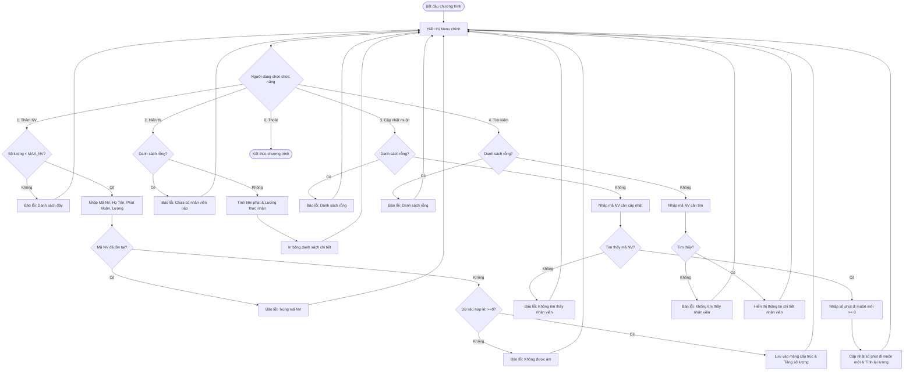

# BÁO CÁO BÀI TẬP LẬP TRÌNH C - XÂY DỰNG HỆ THỐNG QUẢN LÝ CHẤM CÔNG NHÂN VIÊN

> 👤 **Học viên:** Hoàng Công Dũng | **Mã SV:** PTIT-HCM-009
> 🏫 **Môn học:** it102-rl-hoangcongdung

---

## 📊 Sơ đồ thiết kế hệ thống (Activity Diagram)

> 💡 *Sơ đồ dưới đây được render tự động trực tiếp trên GitHub bằng Mermaid. Bạn cũng có thể tải file **`bt1.drawio`** trong repository này để mở và chỉnh sửa trực tiếp trên [Draw.io (diagrams.net)](https://app.diagrams.net).* 

---

## 1. Mục tiêu và Tổ chức Cấu trúc Dữ liệu

Bài tập thực hành môn Lập trình C yêu cầu xây dựng một ứng dụng dòng lệnh (Terminal) để quản lý thông tin nhân viên và chấm công, tính lương thực nhận dựa trên số phút đi muộn.

Để giải quyết bài toán, tôi sử dụng cấu trúc 'struct NhanVien' lưu trữ các thuộc tính maNV, hoTen, soPhutDiMuon và luongCoBan. Hằng số MAX_NV được định nghĩa bằng 50 nhằm giới hạn sức chứa tối đa của mảng tĩnh.

- Sử dụng struct trong C để gom nhóm các kiểu dữ liệu khác nhau của một nhân viên.
- Đảm bảo nguyên mẫu hàm được khai báo đầy đủ trước hàm main() để tuân thủ tiêu chuẩn biên dịch C11.

## 2. Phân tích Các Bẫy Dữ liệu và Xử lý Lỗi (Edge Cases)

Quá trình viết code đòi hỏi phải kiểm soát chặt chẽ các tình huống ngoại lệ để chương trình không bị crash hoặc nhận dữ liệu sai lệch:

Thứ nhất, khi thêm nhân viên mới, chương trình kiểm tra xem mảng đã đạt đến giới hạn 50 phần tử hay chưa và kiểm tra mã nhân viên có bị trùng lặp không.

Thứ hai, các trường hợp nhập số phút đi muộn hoặc lương cơ bản âm đều bị từ chối và yêu cầu nhập lại.

Thứ ba, việc kết hợp giữa 'scanf' và 'fgets' được xử lý triệt để bằng cách xóa bộ đệm bàn phím ('getchar()'), tránh tình trạng trôi lệnh khi nhập họ tên có chứa khoảng trắng.

- Quy tắc phạt đi muộn: Đi muộn từ 15 phút trở xuống miễn phí, quá 15 phút phạt đúng 50.000 VNĐ.
- Kiểm tra danh sách rỗng trước khi thực hiện các thao tác hiển thị, tìm kiếm hoặc cập nhật.

## 3. Bảng Đặc tả Chức năng Hệ thống HRM

Dưới đây là chi tiết các hàm chức năng được cài đặt trong chương trình:

| Tên hàm | Kiểu trả về | Chức năng chính | Xử lý ngoại lệ |
| --- | --- | --- | --- |
| timTheoMaNV | int | Tìm kiếm nhân viên theo mã, trả về chỉ số mảng hoặc -1 | Trả về -1 nếu không tìm thấy |
| themNhanVien | int | Thêm mới nhân viên vào danh sách | Chặn khi quá 50 NV hoặc trùng mã NV |
| hienThiDanhSach | void | Duyệt mảng, tính lương và in danh sách | Báo lỗi nếu danh sách trống |
| capNhatPhutDiMuon | void | Nhập mã NV, cập nhật phút đi muộn mới | Kiểm tra sự tồn tại của mã NV |
| timKiemNhanVien | void | Tìm và in chi tiết thông tin 1 nhân viên | Thông báo không tìm thấy nếu sai mã |

## 4. Mã nguồn Chương trình bằng Ngôn ngữ C (main.c)

Toàn bộ mã nguồn hoàn chỉnh đã được viết tuân thủ chuẩn C11, không sử dụng thư viện ngoài hay con trỏ nâng cao, sẵn sàng biên dịch bằng GCC.

---

## 📁 Danh sách tệp tin nộp bài trong Repository
- 📝 `bt1.docx`: Báo cáo tài liệu phân tích nghiệp vụ hoàn chỉnh.
- 🎨 `bt1.drawio`: File thiết kế sơ đồ chuẩn theo quy định đề bài (mở trực tiếp bằng [Draw.io](https://app.diagrams.net) hoặc Lucidchart).
- 💻 `main.c`: Mã nguồn chương trình.
